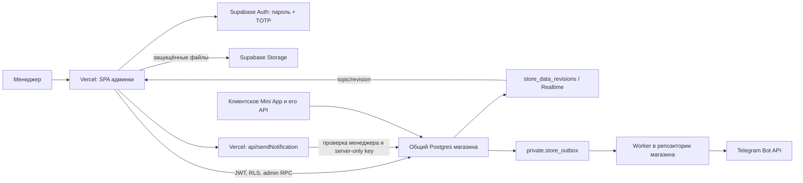
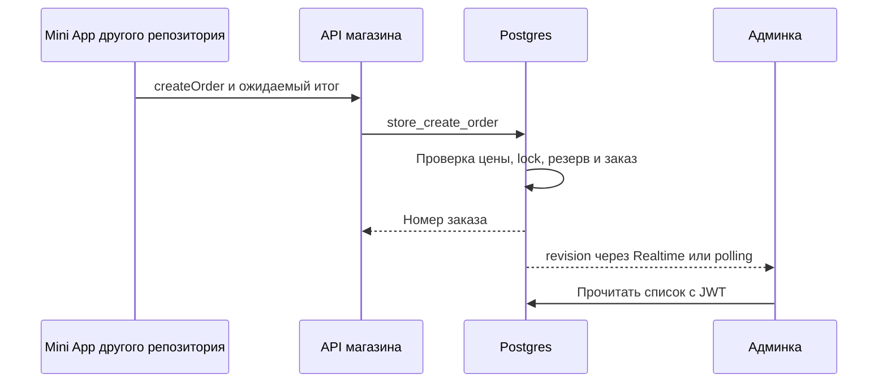
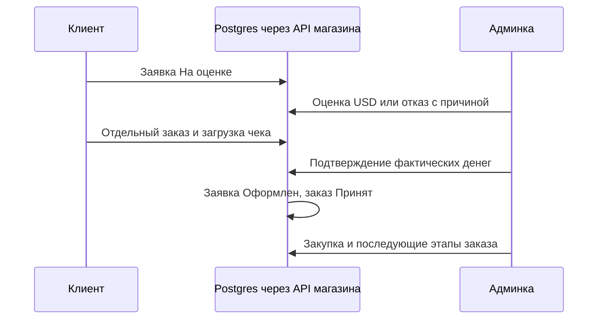
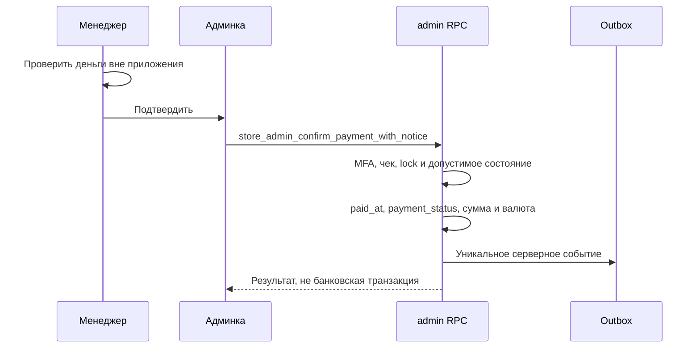
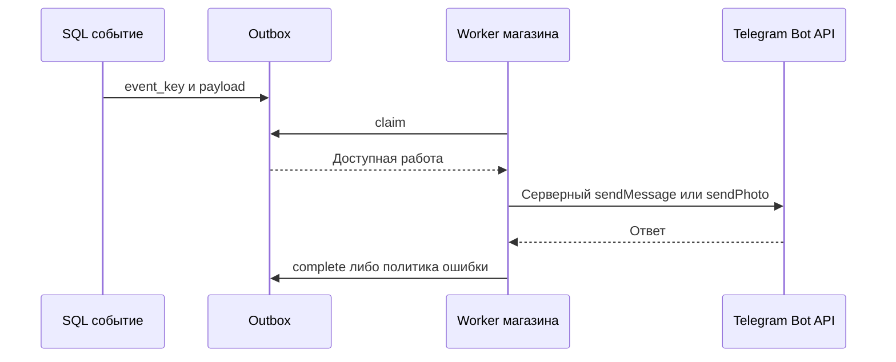
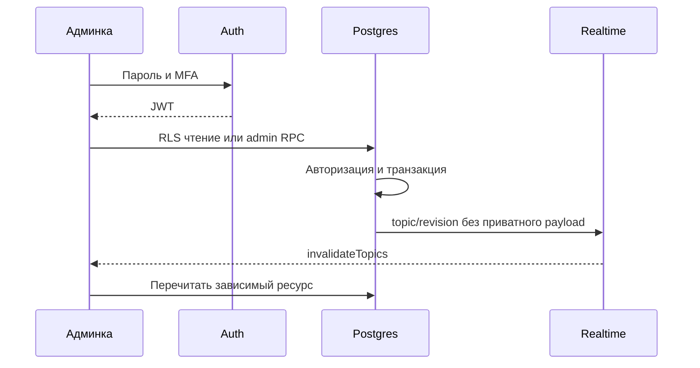

# LOFT Admin — техническая архитектура

Сверено 17.11.2026: админка `7355765`, сервер магазина `b9b9e99`. [PRD](PRD.md), [дизайн](DESIGN_SYSTEM.md), [AGENTS](../AGENTS.md), [серверная архитектура](https://github.com/ttta999/loft-store/blob/main/docs/ARCHITECTURE.md).

## 1. Общая схема и граница репозитория



Админка не владеет отдельной копией заказов. Бизнес-правила реализованы в общей БД и сервере `loft-store`. Схема/миграции находятся **в основном репозитории**. Здесь не создавать параллельную миграционную историю для тех же таблиц.

## 2. Технологии и структура

[package.json](../package.json): React 19, TypeScript 6, React Router 7, Vite 8, Tailwind 4, Supabase JS 2, Lucide/React Icons, Sonner, Node tests и Playwright. Версии точнее смотреть в [lockfile](../package-lock.json). Здесь нет зависимости от Framer Motion и Zustand; анимации используют Web Animations/View Transitions, состояние — React hooks и module-level stores.

| Путь | Назначение |
|---|---|
| [src/App.tsx](../src/App.tsx) | Router и ProtectedLayout |
| `src/pages/` | Рабочие экраны менеджера |
| `src/components/` | Шапка, диалоги, уведомления, задачи, формы, protected media |
| `src/lib/auth.ts` | Вход, MFA и проверка разрешений |
| `src/lib/supabase.ts` | Клиент Supabase, cache scope, чтение данных и signed URL |
| `src/lib/cache.ts`, `resourceCache.ts`, `dataFetch.ts`, `adminLive.ts` | Кеш и инвалидация |
| `src/lib/adminNavigation.ts`, `useAdminDialogRoute.ts`, `useAdminViewState.ts` | Источник перехода, URL диалога и состояние страницы |
| `api/sendNotification.ts`, `server/types.ts` | Узкий серверный endpoint ручного сообщения |
| `src/lib/locales/` | RU/UZ UI-словарь |
| `tests/`, `e2e/` | Unit и browser fixtures |
| `docs/`, корневые security/cache/testing документы | Текущая карта и исторические инструкции |

## 3. Маршруты и состояние

Защищены `/`, `/catalog`, `/orders`, `/china`, `/products`, `/categories`, `/brands`, `/size-charts`, `/refunds`, `/analytics`, `/campaigns`, `/settings`. Вход — `/login`.

`ProtectedLayout` использует `getCurrentUser`/`store_is_admin`; реагирует на Auth events, focus/online/visibility и периодическую проверку. При смене пользователя key layout меняется; кеш очищается. Разрешение UI не является единственной защитой: RPC/RLS повторяют проверку на сервере.

Настройки открываются query `section`. Современные редакторы используют `dialog=edit`, `item=<id|new>`, для предпросмотра кампании `dialog=preview`. [useAdminDialogRoute](../src/lib/useAdminDialogRoute.ts) и [adminNavigation](../src/lib/adminNavigation.ts) сохраняют источник; `parentRoute` даёт безопасный fallback при прямом входе. Origins ограничены whitelist внутренних путей и сохранены в sessionStorage. Не строить Back только как переход на `/`.

[useAdminViewState](../src/lib/useAdminViewState.ts) удерживает фильтры/раскрытые записи; [ScrollRestoration](../src/components/ScrollRestoration.tsx) сохраняет прокрутку и не сбрасывает её при открытии URL-диалога той же страницы. Формы используют `data-loft-dirty`; guard не должен терять несохранённые изменения при Back/смене раздела.

## 4. Данные, RPC и Storage

| Операция | Путь |
|---|---|
| Чтение заказов/заявок/каталога | Supabase Data API с JWT и RLS; большие выборки через `readAll` |
| Создание/сохранение товара с вариантами/рекомендациями | `store_admin_save_product_recommendations`, проверка ожидаемого состояния |
| Чтение точных вариантов | `store_admin_variants`, не публичная таблица остатков |
| Категории/подкатегории/бренды и часть настроек | В существующих местах прямые защищённые RLS-записи; не все изменения — RPC |
| Доставка | `store_admin_save_delivery`, USD-поля |
| Статус заказа/заявки | `store_admin_order_status`, `store_admin_request_status` |
| Деньги/отмена | `store_admin_confirm_payment_with_notice`, `store_admin_cancel_order_reason` |
| Возврат | `store_admin_refunds`, `store_admin_refund_history`, `store_admin_refund_action` |
| Задачи/журнал/напоминания | `store_admin_tasks`, `store_admin_order_history`, `store_admin_reminder_settings` |
| Таблица размеров | `store_admin_size_chart`, активность и RU/UZ матрица/явные метаданные систем |
| Кампания | `store_admin_campaign_action`, `store_admin_campaign_audience`, `store_admin_campaign_tests` |
| Сообщение клиенту | Собственный `/api/sendNotification`, далее серверная очередь |

Таблицы: `orders` с items/деньгами/резервом; `china_requests` с оценкой и двумя связями заказа; `refunds`; `products`, `product_colors`, `product_variants`; `categories`, `subcategories`, `brands`; `settings`, `size_charts`, `product_recommendations`; `campaigns` и `store_data_revisions`. Закрытые `private.*` содержат allowlist, клиентские предпочтения, очередь, аудит, напоминания и получателей кампаний. [Полная карта и миграции](https://github.com/ttta999/loft-store/blob/main/docs/ARCHITECTURE.md).

Raw-статусы в `orders` не равны подписям: например, `Выдан` — получен для самовывоза и передан курьеру для доставки. Заявка `Оформлен` не является статусом выполнения отдельного оплаченного спецзаказа. [PRD](PRD.md) и [orderState](../src/lib/orderState.ts).

Файлы чеков/спецзаявок/возвратов/рассылок защищены. `privateFile` выпускает signed URL на 900 секунд и кеширует его до 12 минут, с user scope; в данных хранится private reference. [ProtectedFile](../src/components/ProtectedFile.tsx) и [SpecialOrderPhoto](../src/components/SpecialOrderPhoto.tsx) обслуживают отображение. Квитанция возврата принадлежит возврату/менеджеру и проверяется SQL перед завершением. Не превращать bucket в public и не публиковать реальные ссылки/реквизиты в документации.

## 5. Авторизация и серверный endpoint

[auth.ts](../src/lib/auth.ts) выполняет `signInWithPassword`, проверяет `store_admin_auth_state`, обрабатывает verified TOTP либо enrollment, затем `challengeAndVerify` и `store_is_admin`. Не удаляет verified-фактор для обхода входа. Серверная функция учитывает `auth.sessions`, срок, allowlist и при требовании `aal2`/verified factor. В UI нельзя заменить это флагом localStorage.

Frontend получает только `VITE_SUPABASE_URL` и публичный anon key. Секрет `SUPABASE_SERVICE_ROLE_KEY` допускается только на сервере. Собственный [api/sendNotification.ts](../api/sendNotification.ts): POST, Supabase JWT, `getUser`, admin check, проверка адресата с заказом/заявкой, rate limit, requestKey и постановка `store_queue_admin_message`. Затем возможна немедленная попытка доставки **уже захваченного события**; незахваченное возвращает queued/202. Это не frontend-вызов Bot API и не обход outbox.

API использует server-only `TELEGRAM_BOT_TOKEN`; worker операционной очереди и manager bot находятся в основном репозитории. Токены и Bot API URL с токеном не логировать. Произвольный незнакомый клиент и неподдерживаемый botType отклоняются. API-ответы `no-store`.

## 6. Реальные направления операций

### Обычный заказ создаёт клиент, админка получает его



### Заявка и специальное оформление



### Подтверждение оплаты



### Telegram-уведомление



Для ручного сообщения путь начинается с `/api/sendNotification`; для кампании используется отдельный worker. Сетевой успех и запись результата не образуют общей транзакции с Telegram. Не обещать абсолютное отсутствие дублей операционных сообщений при потере ответа.

### Административное изменение и обновление списков



## 7. Кеш и Realtime

`ResourceCache` — bounded memory cache (по умолчанию 256 записей), TTL, dedup запросов, invalidation и limited stale read. [cache.ts](../src/lib/cache.ts) — обёртки коллекций, не ещё один независимый кеш.

| Ресурс | TTL из кода |
|---|---|
| Заказы, возвраты | 15 s |
| Спецзаявки, варианты | 30 s |
| Товары, бренды, категории, цвета, подкатегории | 5 min |
| Аналитика, dashboard counts | 60 s; аналитика с device timezone в ключе |
| Детали возврата | 60 s с id, updated_at и scope |
| Signed private URL | 12 min cache при сроке ссылки 15 min |

[DataFetch](../src/lib/dataFetch.ts) кеширует успешные допустимые GET, учитывает authorization/query/headers и проверяет, не сменилась ли идентичность до ответа. Не кеширует auth, mutation, raw stock/revisions и abortable-запросы по условиям реализации. RPC чтения выполняются live на транспортном уровне; их вызывающий ресурс может иметь собственный TTL.

[adminLive](../src/lib/adminLive.ts) слушает `store_data_revisions`: `postgres_changes`, опрос раз в 30 s, фокус/online/visibility. `invalidateTopics` снимает зависимые resource/HTTP ключи; `useAdminRefresh` объединяет bursts и перечитывает список, сохраняя локальные фильтры/форму. Смена Auth пользователя/sign-out очищает кеш. Это не broadcast полных клиентских записей в публичный канал.

Нельзя обещать бесконечный offline cache всех страниц. При ошибке оставляют допустимые сохранённые данные либо показывают error/retry; stale не является разрешением на оплату/складскую запись. После мутации использовать действующие invalidation helpers, не ручную перезагрузку всего приложения.

## 8. Время, локализация и аналитика

[i18n](../src/lib/i18n.ts) хранит язык отдельно для manager id, публикует его через `useSyncExternalStore`; `t` типизирован ключами RU/UZ словарей, `tx` переводит только известные UI строки. Не переводить пользовательский контент/SQL raw-статусы автоматически. Тема — отдельный module store [theme.ts](../src/lib/theme.ts).

[dateTime](../src/lib/dateTime.ts), `adminDateTime` и `useLocalTimeZone` используют зону устройства, без GPS/IP. План рассылки преобразуется в UTC до RPC. [workHours](../src/lib/workHours.ts) проецирует фиксированное окно `Asia/Tashkent` в локальные часы менеджера; новые настройки возвращаются в серверную зону. Исторические инстанты не пересчитываются.

[revenue](../src/lib/revenue.ts) определяет подтверждённую выручку по статусу, `paid` и валидному `paid_at`; [AnalyticsPage](../src/pages/AnalyticsPage.tsx) строит представления, [cache](../src/lib/cache.ts) включает зону устройства. Отмена/возврат не должны превращаться в продажи сменой UI-фильтра.

## 9. Фоновые задачи и рассылки

Сама админка не является постоянно работающим scheduler. `ManagerTasks` читает вычисленные сервером задачи; `ReminderSettings` сохраняет правила. Очереди напоминаний, поступлений, service-уведомлений и campaigns выполняет сервер основного репозитория через pg_cron/pg_net и Vercel workers. [Описание сервера](https://github.com/ttta999/loft-store/blob/main/docs/ARCHITECTURE.md).

Кампании имеют frozen-аудиторию, версии, lease и ограничение темпа. `uncertain` отделён от failed/retry, чтобы не дублировать сообщение при неизвестном исходе. Маркетинговое согласие — отдельный признак, не `subscribers.is_subscribed`. Конкретная активация jobs, напоминаний и delivery state не проверялась в этой документационной задаче.

## 10. Развёртывание и проверки

[Vercel config](../vercel.json): SPA rewrite кроме `api/`/`assets/`, строгий CSP, `frame-ancestors 'none'`/`X-Frame-Options: DENY`, запрет геолокации/камеры/микрофона. HTML revalidate; versioned assets immutable на год. Админка не должна встраиваться как клиентское Telegram-приложение.

Секреты server endpoint: Supabase URL, anon key для проверки пользовательского JWT, service role для серверной очереди, client bot token. Только имена конфигурации в документах. Репозиторий не доказывает, что переменные настроены на Vercel. Серверный исходник обрабатывается отдельным `tsconfig.server.json` в build.

Команды из [package.json](../package.json):

```sh
npm ci
npm run dev
npm test
npm run build
npm run lint
npm run test:e2e
```

`build` включает app/server TypeScript и Vite. Отдельного `npm run typecheck`, `test:all`, `test:csp` в админке нет. Локальный Playwright [config](../playwright.config.ts) запускает порт 4174 с fixture env; [e2e](../e2e) изолируют данные. Общие межрепозиторные проверки запускаются **из магазина** с `LOFT_ADMIN_ROOT`, а SQL — там же в изолированной базе. Не запускать настоящие заказы/уведомления для тестов без явного разрешения. WebKit iPhone viewport не подтверждает физический iPhone.

## Ограничения и расхождения

- README исторически шаблонный; старые security/cache/testing отчёты имеют даты и не заменяют текущий код.
- Не все модалки переведены на `AdminDialog`: часть исторических форм остаётся собственной разметкой. Не утверждать единый focus trap/ARIA для всего проекта.
- Большинство критичных действий — RPC, но бренды/категории/часть settings имеют direct RLS writes. Нельзя документировать «все записи только через свой API».
- Исключение из общего отсутствия сообщений у черновиков: новый спецзаказ ставит платёжный prompt до чека. Общая история при этом фильтрует черновики перевода; переход по ссылке такого сообщения до чека требует отдельной изолированной проверки. Отмена не отзывает уже доставленный prompt. Это зафиксированная граница, код не менялся.
- Обычные service-шаблоны бота ещё содержат RU-текст, хотя UI/кампании поддерживают RU/UZ.
- Рабочие часы отображаются с локальной проекцией; серверный timezone фиксирован, ручного выбора зоны нет.
- Production MFA, RLS-актуальность окружения, Vault/Cron, реальные платежи и доставки не проверялись здесь. Исходный код — описание намерения и проверок, не гарантия настройки окружения.
- Полного входящего обработчика бота, WMS, мульти-магазинов и банка-эквайера в этих репозиториях не найдено.
- Изменения SQL выполняются новой миграцией в `loft-store`; старые установочные скрипты не переисполняются для «синхронизации» админки.

Функциональный код и база при подготовке документов не менялись. Подробные общие финансовые ограничения: [PRD магазина](https://github.com/ttta999/loft-store/blob/main/docs/PRD.md).

## Уточнение сетки брюк и джинсов — 19.11.2026

`src/lib/shopSizeGrid.ts` определяет сетку 36–56 для clothes/pants,trousers,jeans. ProductsPage предлагает её для новых товаров, при редактировании объединяет с исходными значениями вариантов текущего цвета. CategoriesPage фиксирует numeric и 11 значений для соответствующих существующих подкатегорий. Серверная миграция принадлежит loft-store: 20261119170446_pants_jeans_shop_grid.sql. Она меняет только defaults; product_variants и orders не затрагиваются. Источник реальной размерной системы производителя — существующие явные метаданные таблиц, не автоматическое M→число.
