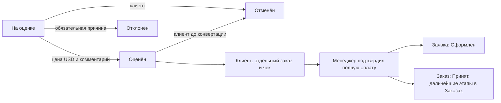
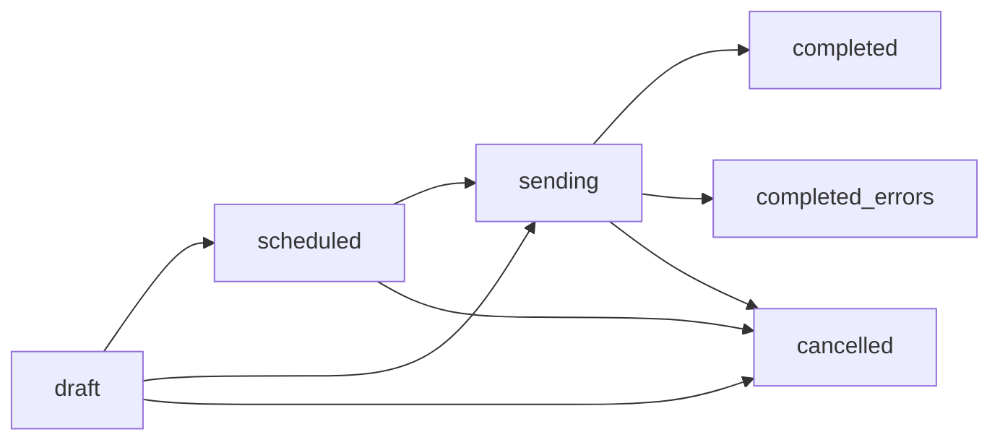

# LOFT Admin — продукт и рабочие процессы менеджера

Актуальность: 17.11.2026, код админки `7355765`; сервер магазина `b9b9e99`. Подтверждение кодом не означает выполнение реальных финансовых операций при документировании.

[Архитектура](ARCHITECTURE.md), [дизайн](DESIGN_SYSTEM.md), [AGENTS](../AGENTS.md), [общие правила продукта](https://github.com/ttta999/loft-store/blob/main/docs/PRD.md).

## Назначение и роли

Админка — отдельное веб-приложение для сотрудников LOFT Store: управление ассортиментом, обработка обычных и специальных заказов, проверка денег и возвратов, контроль задач и согласованные рассылки. Покупатель оформляет заказ в другом репозитории. Админка не является Telegram Mini App и не использует клиентскую Telegram session как разрешение менеджера.

Пользователь должен пройти Supabase Auth и проверку разрешённого администратора; при требовании — TOTP/MFA. Регистрация Auth-пользователя сама по себе не даёт доступ к магазину. Подробности: [auth](../src/lib/auth.ts).

## Разделы и сценарии

| Раздел | Реализовано | Ключевая граница |
|---|---|---|
| Главная `/` | Сводка, переходы, задачи, колокольчик | Выручка не равна сумме всех созданных заказов |
| Каталог `/catalog` | Меню товаров, категорий, брендов, таблиц | Это навигационный раздел, не ещё один источник каталога |
| Товары `/products` | Формы товара, цвета/фото, варианты/остатки, активность, рекомендации | Критичное сохранение через серверный RPC, защита конкурирующего изменения |
| Категории `/categories` | Категории/подкатегории, порядок, активность, иконки, размеры | Отключение не означает удаление исторических заказов |
| Бренды `/brands` | Название, логотип, активность, редактирование | Активность связана с видимостью клиентского каталога |
| Таблицы `/size-charts` | Визуальная RU/UZ таблица, область, шаблоны, строки/колонки, preview, скрытие | Шаблоны пустые; соответствия размеров требуют данных производителя |
| Заказы `/orders` | Поиск, фильтры, состав/варианты, получение, чек, история, действия | Не менять raw-статус прямой записью вместо RPC |
| Спецзаказы `/china` | Заявки, оценка USD/комментарий, отказ с причиной, фото, связь с заказом | Выполнение оплаченного спецтовара ведётся в `/orders` |
| Возвраты `/refunds` | Назначение, проверка денег, сумма/валюта, квитанция, завершение, аудит | Не выполняет банковский перевод |
| Аналитика `/analytics` | Периоды, выручка/заказы, дневные, товарные, категорийные и брендовые данные | Сохранённые снимки заказа и подтверждённые деньги, не текущие цены каталога |
| Рассылки `/campaigns` | Создание/копия, фото, RU/UZ контент, preview, аудитория, тест, запуск/план/остановка, статистика | Только отдельное согласие, не все `subscribers` автоматически |
| Настройки `/settings` | Подразделы payments/prices/sale/theme/reminders | Смена настроек не переписывает историю |

Источники: [маршруты](../src/App.tsx), [страницы](../src/pages), [меню и origin navigation](../src/lib/adminNavigation.ts).

## Работа с каталогом

1. Выбрать категорию/подкатегорию, существующую систему размеров и бренд.
2. Ввести названия RU/UZ, описания, USD-цену, при необходимости цену скидки, изображения.
3. Настроить цвета и фактические варианты размера/цвета с остатками.
4. Проверить активность и рекомендации/дополнения к образу.
5. Сохранить через существующий механизм, который проверяет актуальность данных и ограничения незавершённых резервов. Не обходить конфликт повторным слепым сохранением.

Кнопки добавления имеют полные названия и единый стиль. Отсутствие технических ID в пользовательской строке не означает, что идентификаторы можно удалить из payload.

Таблица размеров выбирается по области: товар → подходящий бренд → подкатегория → категория. В редакторе можно указать **подтверждённую** исходную систему, целевую систему и колонки; это не автоматический перевод произвольного текста. Пустые/скрытые/неподходящие таблицы не дают клиентскую кнопку. Клиент не выбирает покупаемый размер автоматически. [Редактор](../src/components/SizeChartEditor.tsx), [проверки](../src/lib/sizeChartEditor.ts), [контракт сервера](https://github.com/ttta999/loft-store/blob/main/supabase/migrations/20261117110219_explicit_size_chart_mapping.sql).

## Заказы: принятие, деньги и выполнение

`online_card` — перевод по реквизитам с ручной проверкой, а не автоматический эквайринг. Для доставки перевод обязателен. Обычный самовывоз может иметь `upon_receipt`. Новый спецтовар — всегда полная предоплата и отдельное оформление одной позиции/количества 1.

Чек означает «требует проверки», а не `paid`. Менеджер проверяет фактическое поступление вне приложения, затем нажимает подтверждение; RPC проверяет право, состояние и доказательство оплаты. Записываются сумма, валюта и `paid_at`. Прямое присвоение статуса «Принят» не заменяет платёж.

| Workflow | Хранимые переходы | Подписи / условия |
|---|---|---|
| Обычный перевод | `Ожидает оплаты` → `Активный` после подтверждения | С чеком и pending интерфейс показывает «На обработке» |
| Обычный самовывоз | `Активный` → `В обработке` → `Готов` → `Выдан` | Принят → Собирается → Готов к выдаче → Получен |
| Обычная доставка | `Активный` → `В обработке` → `Выдан` → `Доставлен` | На курьера идут сразу из сборки; `Выдан` здесь значит «Передан курьеру» |
| Специальное выполнение | `Ожидает оплаты` → `Принят` → `Заказан у поставщика` → `В пути` → `Прибыл в страну` → `Собирается` | Полная подтверждённая оплата обязательна |
| Спецтовар, самовывоз | `Собирается` → `Готов к выдаче` → `Получен` | Последовательное выполнение |
| Спецтовар, доставка | `Собирается` → `Передан курьеру` → `Доставлен` | Ссылка курьера необязательна |
| Legacy `Упакован` | Обычная доставка → `Выдан`; спецтовар → `Передан курьеру` | Только совместимость старых записей |

У обычного самовывоза с оплатой при получении переход в raw `Выдан` одновременно фиксирует поступление денег. У перевода продвижение до `paid` и `paid_at` запрещено. Терминальные полученные/доставленные записи не отменяются этим механизмом. Все переходы — серверная разрешённая последовательность, а не произвольный select.

Источник подписи/действий: [orderState](../src/lib/orderState.ts), [specialOrders](../src/lib/specialOrders.ts). Финальная серверная таблица переходов: [SQL магазина](https://github.com/ttta999/loft-store/blob/main/supabase/migrations/20261112172104_streamline_delivery_and_special_notices.sql). Полные правила и исключения: [PRD магазина](https://github.com/ttta999/loft-store/blob/main/docs/PRD.md).

## Заявки на спецзаказ

Оценка и отказ разрешены из `На оценке`. Повтор идентичных параметров безопасен; повторная оценка с новой ценой после изменения состояния сервером не разрешена. `reserved_order_id` — временное оформление, `converted_to_order_id` — завершённая связь. Для новых спецзаказов чек не делает заявку оформленной: это происходит после подтверждения денег. Номер заявки сохраняется в составе заказа; номер заказа и номер заявки не взаимозаменяемы.

## Отмены и возвраты

Отмена менеджером использует отдельную форму с причиной. После передачи курьеру и на поздних этапах спецзаказа нужно ручное согласование. Склад освобождается один раз сервером; нельзя добавлять остаток вручную поверх успешной отмены.

Чистый черновик перевода без чека/денег при отказе скрывается из клиентской истории и не должен порождать сообщение об оформленном заказе. Исключение по уведомлениям: новый спецзаказ имеет платёжный prompt ещё до чека; отмена закрывает ожидающие события, но не отзывает доставленный prompt. Отмена после чека может требовать проверки поступления. Подтверждённые деньги требуют финансового возврата, а не только статуса `Отменён`.

| Состояние | Действие | Условие / результат |
|---|---|---|
| Любой незавершённый возврат | `claim` | Взять на себя; чужое назначение блокирует конкурентную работу |
| `Проверка платежа` | `payment_received` | Реальная положительная сумма/валюта → `Ожидает возврата` |
| `Проверка платежа` | `no_payment` | `Возврат не требуется` |
| `Ожидает возврата` | `proof` | Квитанция фактического обратного перевода, защищённый файл |
| `Ожидает возврата` | `complete` | Требуется квитанция; → `Возврат выполнен`, заказ `refunded` |
| `Возврат не требуется` | `payment_received` повторно | Только с причиной повторной проверки и фактическими деньгами |
| `Возврат выполнен` | Новая выплата тем же workflow | Запрещена |

Действия после claim доступны назначенному менеджеру. Один request key нельзя повторно использовать с другим содержимым. Причины, предыдущие/новые состояния и акторы сохраняются в аудите. [UI](../src/pages/RefundsPage.tsx), [RPC helpers](../src/lib/refunds.ts), [SQL](https://github.com/ttta999/loft-store/blob/main/supabase/migrations/20261112120358_order_refunds.sql).

## Аналитика и деньги

[revenue.ts](../src/lib/revenue.ts) учитывает допустимые статусы, `payment_status='paid'`, валидный `paid_at` и конечную неотрицательную USD-сумму. Счётчик заказов, средний чек, ожидающие оплаты и отмены — разные показатели. Товарные/категорийные/брендовые итоги и топ-товары строятся на имеющихся снимках/данных. Это операционная аналитика магазина, не банковская бухгалтерская сверка.

Текущий курс/новая цена не должны пересчитывать старый заказ. USD — 2 знака, UZS — целые; стоимость доставки и положительный порог бесплатной доставки настраиваются в USD. Исторические неизвестные суммы/валюты должны требовать проверки, а не подменяться нулём. [money](../src/lib/money.ts), [orderState](../src/lib/orderState.ts).

## Колокольчик, задачи, напоминания

[NotificationBell](../src/components/NotificationBell.tsx) получает события из данных заказов/заявок, включая спецзаказы и чек, показывает состав заказа. Последнее просмотренное время хранится локально с идентичностью менеджера. Это не Web Push и не серверная синхронизация прочтения между всеми устройствами.

[ManagerTasks](../src/components/ManagerTasks.tsx) использует `store_admin_tasks`: очередь производных задач по состояниям заказа/заявки/возврата, а не редактор произвольных задач. Включены проверка платежа, оценка, закупка, сборка, самовывоз, возврат. Напоминания имеют индивидуальные сроки, включение, Telegram-флаг и повтор; серверная зона магазина `Asia/Tashkent` не вводится менеджером. UI проецирует рабочие часы в местную зону через `workHours` и хранит серверные значения. Начальные правила в миграции выключены; production-включение отдельно проверяется.

## Рассылки

| Шаг | Реализованное правило |
|---|---|
| Создать | Название, текст/заголовок, необязательное фото, кнопка/цель, исходный язык и переводы |
| Аудитория | `all`, `buyers`, `brand`; отдельное маркетинговое согласие, доступность чата; покупки подтверждены |
| Предпросмотр | Проверка контента и целевой ссылки, расчёт аудитории |
| Тест | Только серверно настроенный чат, а не произвольный получатель из браузера |
| Запуск/план | Фиксация аудитории и контента; локальный ввод менеджера преобразуется в UTC |
| Отправка | Worker, throttle и lease; consent/доступность перепроверяются |
| Завершение | `completed` либо `completed_errors`; отдельные sent/failed/skipped/uncertain |
| Остановить | `cancelled`, ожидающие адресаты пропускаются; уже отправленные сообщения не отзываются |

На сетевую неопределённость worker не должен слепо повторять рекламное сообщение; `uncertain` — отдельный результат. Время планирования после сохранения не меняется от поездки менеджера в другую страну. [CampaignsPage](../src/pages/CampaignsPage.tsx), [сервер worker](https://github.com/ttta999/loft-store/blob/main/server/campaignDelivery.ts).

## Настройки и границы развития

Настройки содержат реквизиты по валютам, доставку/порог, курс, скидочный режим, язык/тему и напоминания. Значения реквизитов и клиентские данные в документации не публикуются. Изменение настроек не должно менять исторические суммы или переоткрывать оплаченные заявки.

Подтверждено кодом: перечисленные экраны, RPC-вызовы, кеш, локализация UI и ограничения. Требует проверки окружения: allowlist/MFA конкретного сотрудника, jobs/Vault, реальные сообщения и банковские операции. Частично: синхронизация языка внешнего бота; готовые RU/UZ кампании не означают перевод всех сервисных шаблонов. Запланировано только как идеи: intro в клиенте, WMS, несколько магазинов. Модель текущей админки не разделяет магазины/тенанты.

Наличие формы и успешный frontend click сами по себе не означают успешно сохранённый серверный результат. Противоречия с ранними ТЗ и ограничения проверок перечислены в [архитектуре](ARCHITECTURE.md#ограничения-и-расхождения).

## Уточнение сетки брюк и джинсов — 19.11.2026

Новые товары подкатегорий Брюки/Джинсы используют только числовую сетку 36, 38, 40, 42, 44, 46, 48, 50, 52, 54, 56. Существующие значения вариантов и остатки сохраняются, включая legacy-буквы; менеджер видит предупреждение о ручном сопоставлении. Дубликат — новый товар: его остатки вводятся заново по согласованной сетке, исходный товар не меняется. Сетка магазина не является универсальной конвертацией производителя.
